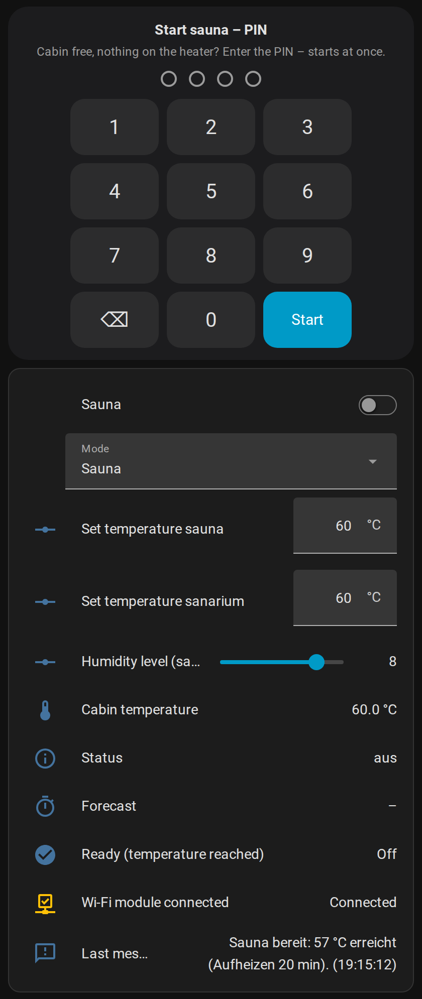

# KLAFS sauna – local control for Home Assistant (no cloud)

> **Disclaimer:** This is an independent hobby project. It is **not** made, endorsed, supported or checked by
> KLAFS GmbH & Co. KG and has **no** connection to KLAFS. KLAFS and SANARIUM are trademarks of their owners and are
> used here only to describe compatibility. Use entirely **at your own risk**. The software is provided free of charge
> "as is", without any warranty (see [LICENSE](LICENSE)); liability is excluded as far as the law permits. Mandatory
> statutory liability (e.g. for intent or gross negligence, or for injury to life, body or health) is not affected.
> Warnings and the PIN in this app are **no** substitute for the safety devices of the sauna itself.

Home Assistant app (add-on) that replaces the KLAFS cloud for the KLAFS sauna Wi-Fi module. The module connects to
this app instead of the cloud; the sauna appears in Home Assistant via MQTT: start with a PIN, stop, mode
(sauna/sanarium), set temperatures, humidity level, cabin temperature, status, "ready", messages.

## Screenshot

*Example dashboard: PIN keypad (starts as soon as the PIN is complete) and the sauna entities. Status texts follow the
language option of the app.*

Features:
- start only with a PIN (lock or keypad card), optional preset time; stop with the switch
- start while the module is offline is queued for up to 1 h; each start is checked after 3 min and resent once
- heat-up forecast "ready at about HH:MM", heated %, minutes to ready – learned from your own heat-ups
- messages for push notifications: heating up, 50 % heated, ready, temperature not rising
- no hard-coded device data: the frame header is learned from the module

**Status:** experimental, runs on **one** installation only (control 18033 with Wi-Fi module). Other controls,
heaters or modules are **untested** – do not use it there. Protocol reverse-engineered from a recording – see [klafs_local/DOCS.md](klafs_local/DOCS.md). The KLAFS app does not work while the module is
connected to this app.

## ⚠️ Safety first – read before use

A sauna heater can start a fire. This software switches a heater on remotely – treat it accordingly:

- **Only switch on when someone is at home** and can react (e.g. in case of a fire in the cabin). Never start the sauna
  while nobody is in the house.
- **Before every start check the cabin**: nothing on or near the heater (towels, clothes, wood, cleaning agents),
  door closed, ventilation free.
- KLAFS allows remote switch-on **only together with a safety device** (safety contact switch SKS over the heater,
  BONATHERM under-bench heater, or a key switch). This app adds a PIN in Home Assistant – it does **not** replace a
  safety device, and it does not replace the over-temperature limiter or the maximum operating time of the control.
  Never bypass or change these protections. **Use this app only if your sauna already has such a safety device that
  is approved for remote switch-on** (check the KLAFS manual of your control/heater, or ask your KLAFS dealer or
  electrician). Without it, do not use remote start at all.
- The protocol was reverse-engineered; commands can be lost (e.g. the Wi-Fi module drops the connection). Always make
  sure you can switch off at the control panel. **Double-check everything** in your own installation before relying on it.
- You alone are responsible for your installation and its operation. No warranty – see [LICENSE](LICENSE).

## Installation

1. Settings › Apps (Add-ons) › App store › ⋮ › Repositories → add `https://github.com/quitkelvin/ha-klafs-local`.
2. Install **KLAFS Sauna local**, set *Start PIN* (and *Device PIN* if the control does not use the factory 1234), start.
3. Point the Wi-Fi module to Home Assistant: in the module settings enter the IP of your Home Assistant as server,
   port 28888 – or redirect the cloud address on your router (see DOCS.md, "DNAT").
4. Sauna control, service menu **20 KEY**: the safe default is **1** – a key switch must confirm every start (the app
   still works, the start just waits for the key; after 3 min it reports "not running"). Set **20 KEY = 2**
   ("remote", start without key) **only** if an approved safety device (SKS over the heater or BONATHERM) is installed
   and the manual allows remote start for your installation. With 0 a remote start is only "requested".

## Dashboard

- Entities: `switch.klafs_sauna_sauna` (off = stop), `lock.klafs_sauna_start_pin` (unlock with PIN = start),
  `select.klafs_sauna_modus`, `number.klafs_sauna_temp_sauna`, `number.klafs_sauna_temp_sanarium`,
  `number.klafs_sauna_feuchte_stufe`, `sensor.klafs_sauna_temperatur`, `sensor.klafs_sauna_status`,
  `binary_sensor.klafs_sauna_verbunden`, `binary_sensor.klafs_sauna_bereit`, `sensor.klafs_sauna_hinweis`,
  `sensor.klafs_sauna_feuchte`, `sensor.klafs_sauna_aufgeheizt` (%), `sensor.klafs_sauna_prognose`,
  `sensor.klafs_sauna_minuten_bis_bereit`.
- [dashboard/pin-card.js](dashboard/pin-card.js): keypad card – the sauna starts as soon as the PIN is complete
  (one step instead of "unlock" + PIN). Copy to `/config/www/`, add as dashboard resource, then
  card type `custom:bubble-pin-card`, see [dashboard/example.yaml](dashboard/example.yaml).

---

## Kurz auf Deutsch

App (Add-on) für Home Assistant, die die KLAFS-Cloud ersetzt: Das WLAN-Modul der Sauna verbindet sich mit der App,
die Sauna erscheint per MQTT in HA – Start mit PIN, Stopp, Modus, Soll-Temperaturen, Feuchte, Kabinentemperatur,
Status, „bereit“, Prognose „fertig ca.“ und Aufheiz-Meldungen; Start bei offline wird bis 1 h nachgeholt. Getestet nur an
einer Anlage (Steuerung 18033) – andere Modelle ungetestet. Servicemenü
**20 KEY**: sicherer Standard **1** (Schlüsselschalter bestätigt jeden Start); **2** („Fern“) nur, wenn eine für den
Fernstart zugelassene Sicherheitseinrichtung (SKS-Gitter oder BONATHERM) eingebaut ist und die Anleitung es erlaubt.

**Haftungsausschluss:** Unabhängiges Hobbyprojekt – **keine** Verbindung zur KLAFS GmbH & Co. KG, nicht von KLAFS
geprüft oder unterstützt. KLAFS und SANARIUM sind Marken ihrer Inhaber. Nutzung **auf eigene Gefahr**; unentgeltlich und
ohne Gewährleistung (siehe LICENSE), Haftung ausgeschlossen, soweit gesetzlich zulässig. Zwingende gesetzliche Haftung
(z. B. bei Vorsatz, grober Fahrlässigkeit oder Verletzung von Leben, Körper, Gesundheit) bleibt unberührt.

**Sicherheit:** Nur einschalten, wenn jemand zu Hause ist und im Brandfall eingreifen kann. Vor jedem Start Kabine
prüfen (nichts auf oder am Ofen). KLAFS erlaubt Fernstart nur mit Sicherheitseinrichtung (SKS-Gitter, BONATHERM oder
Schlüsselschalter) – die PIN in HA ersetzt das nicht, ebenso wenig Temperaturbegrenzer und Abschaltzeit der Steuerung.
Ohne eine solche, für den Fernstart zugelassene Einrichtung die App nicht verwenden.
Ausschalten am Bedienteil muss immer möglich sein. Alles in der eigenen Anlage doppelt prüfen. Keine Gewährleistung.
